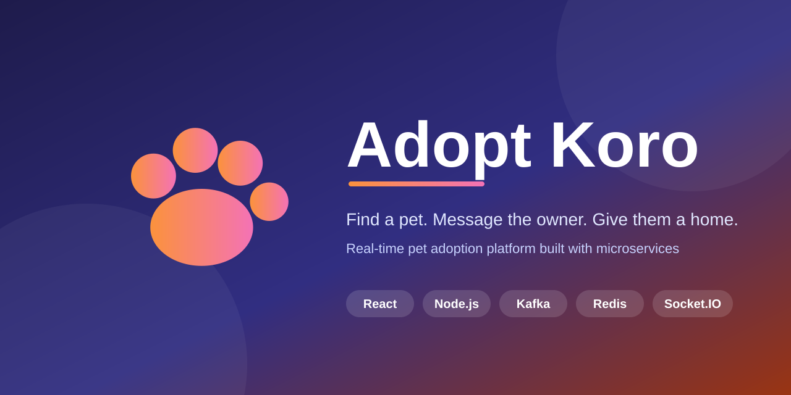

<div align="center">



<br/>

**A real-time pet adoption platform built on a microservice architecture.**

<p>
  
  
  
  
  
  
  
</p>

<p>
  <a href="#features">Features</a> ·
  <a href="#architecture">Architecture</a> ·
  <a href="#getting-started">Getting started</a> ·
  <a href="#api-overview">API</a>
</p>

</div>

---

## Features

| | |
|---|---|
| **Flexible auth** | Google sign-in, or email + password with OTP for login, registration and password reset |
| **Adoption posts** | Create listings with up to 5 photos, mark them adopted or available |
| **Nearest pets** | Browse posts closest to your chosen district first, filtered by category, with infinite scroll |
| **Real-time chat** | Message post owners instantly, with seen receipts and unread badges |
| **Encrypted messages** | Chat text is encrypted before it is stored |
| **Built to scale writes** | Posts and chat messages are written through Kafka in batches |
| **Rate limiting** | Token bucket rate limiter on the post endpoints protects PostService from abuse and traffic bursts |

## Architecture

<div align="center">
  
</div>

| Service | Responsibility | Data |
|---|---|---|
| **Gateway** | Reverse proxy for `/api/auth`, `/api/post`, `/api/interaction` | none |
| **UserService** | Google OAuth, OTP auth, JWT sessions, logout blocklist | `users` `sessions` `otps` |
| **PostService** | Post CRUD, nearest-first feed, Redis feed cache, token bucket rate limiting | `posts` `categories` `districts` `users`\* |
| **InteractionService** | Chat, Socket.IO, unseen counts, message encryption | `conversations` `chats` `users`\* |

Each service owns its own MongoDB database. \* `users` is a read replica kept in sync through Kafka.

<details>
<summary><b>How data moves between services</b></summary>

<br/>

- **Registration:** UserService publishes new users to the `registration` topic. PostService and InteractionService consume it and upsert into a local `users` collection.
- **Posts:** `createPost` publishes to the `posts` topic. PostService consumes in batches and bulk-inserts.
- **Chat:** `sendText` encrypts the message and publishes to the `chat` topic. InteractionService bulk-inserts in batches and also pushes the message to clients over Socket.IO right away.
- **Cross-service reads:** InteractionService calls PostService's `getPost` through the Gateway to validate a post when a conversation starts.

</details>

<details>
<summary><b>Redis and Socket.IO details</b></summary>

<br/>

**Redis**
- PostService: feed cache (sorted set + hash per post, short TTL) and a lock to prevent cache stampedes on the nearest feed
- UserService: token blocklist on logout
- InteractionService: Socket.IO adapter (Pub/Sub) so several instances can broadcast to each other

**Socket.IO rooms**
- `room:<userId>`: joined on connect, used for chat list updates and unread counts
- `room:<conversationId>`: joined when a chat is opened (membership is verified), used for live messages

</details>

## Tech stack

| Layer | Tools |
|---|---|
| Frontend | React, React Router, Axios, Socket.IO client, `@react-oauth/google`, react-toastify |
| Backend | Node.js, Express 5, Mongoose, JWT, bcrypt, Multer + Cloudinary |
| Messaging | Kafka (KafkaJS, managed on Aiven) |
| Cache / realtime | Redis (ioredis), Socket.IO with Redis adapter |
| Database | MongoDB, one database per service |

## Project structure

```
adopt-koro/
├── Gateway/              # API gateway
├── UserService/          # auth and sessions
├── PostService/          # listings and feeds
├── InteractionService/   # chat and Socket.IO
├── client/               # React app
└── docs/                 # banner and images
```

## Getting started

### Prerequisites

- Node.js 20+
- MongoDB, Redis and a Kafka cluster (topics: `registration`, `posts`, `chat`)
- Google OAuth credentials and a Cloudinary account

### Setup

```bash
# 1. clone
git clone https://github.com/<your-username>/adopt-koro.git
cd adopt-koro

# 2. configure: copy .env.example to .env in every service and fill it in
for s in Gateway UserService PostService InteractionService; do cp $s/.env.example $s/.env; done
cp client/.env.example client/.env

# 3. install and run each service
cd UserService && npm install && npm run dev
```

Repeat step 3 for `PostService`, `InteractionService`, `Gateway` and `client`.
Start order: databases, Redis, Kafka, the three services, Gateway, then the client.

## API overview

All requests go through the Gateway.

| Prefix | Endpoints |
|---|---|
| `/api/auth` | `login-initiate` · `login-verify` · `register-initiate` · `register-verify` · `forgot-password` · `reset-password` · `authenticate` · `logout` |
| `/api/post/public` | `catsAndDistricts` · `getNearestPosts` · `getPost` |
| `/api/post/private` | `create` · `getUserPosts` · `updatePost` |
| `/api/interaction/message` | `sendText` · `getText` · `chatList` · `messageCount` |

## Roadmap

- [ ] Docker Compose for one-command local setup
- [ ] Deployment
- [ ] Image moderation
- [ ] Push notifications for new messages

## License

Released under the [MIT License](LICENSE).
